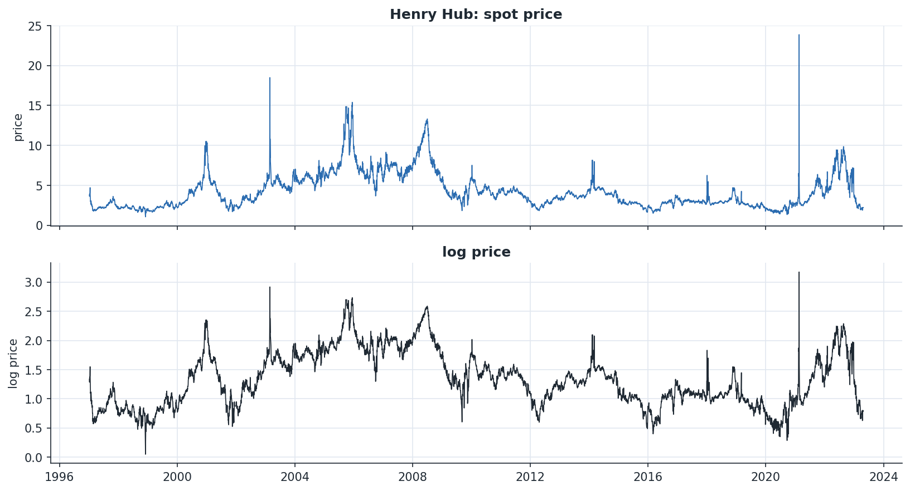
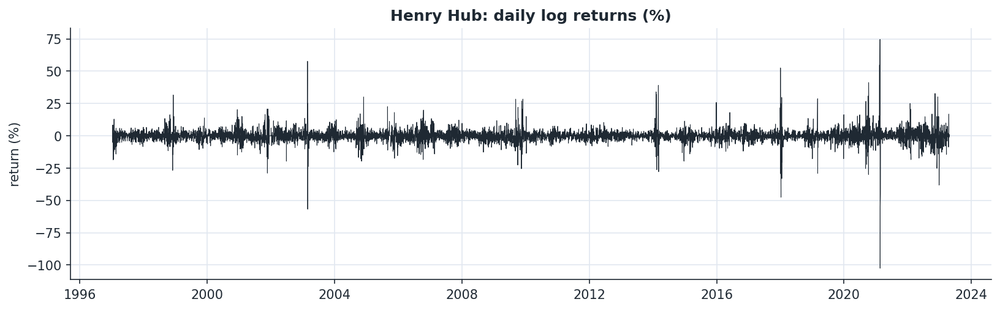
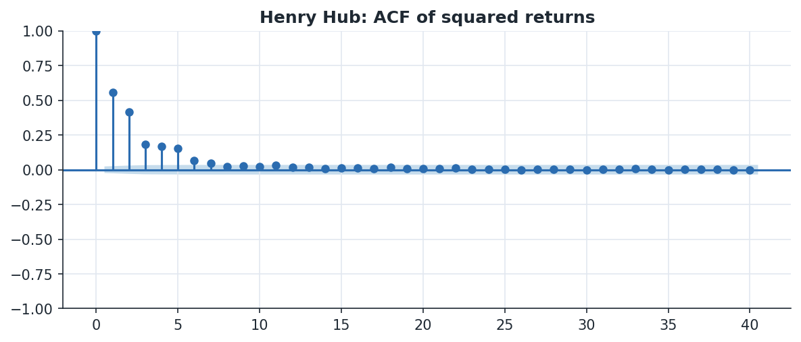
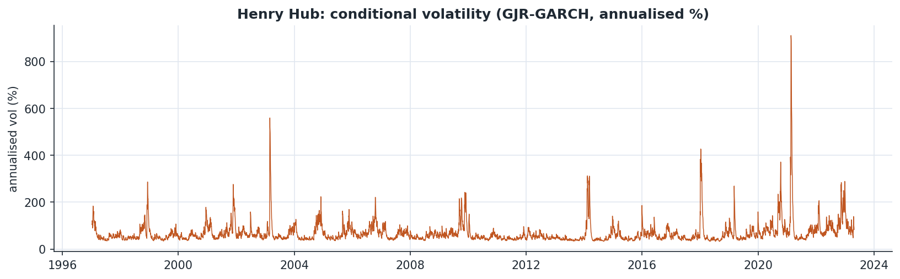
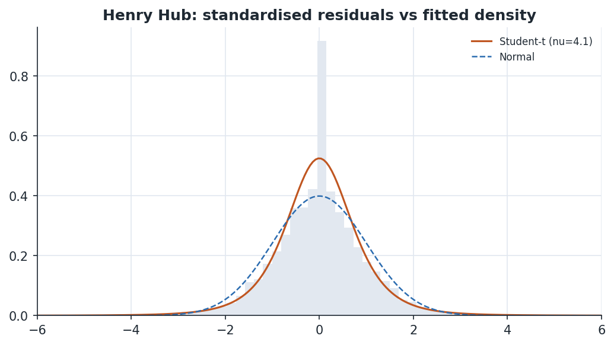
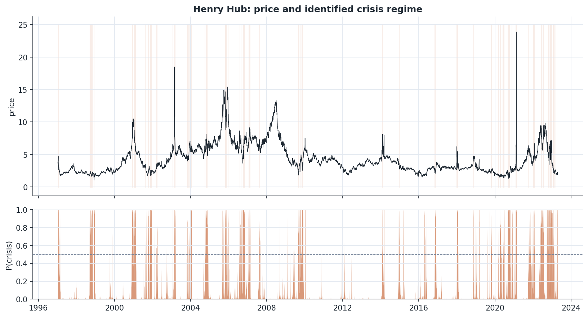
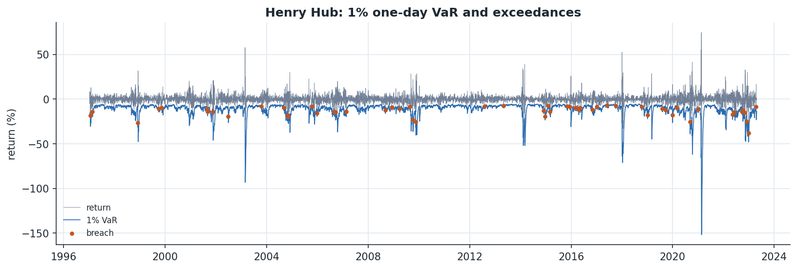
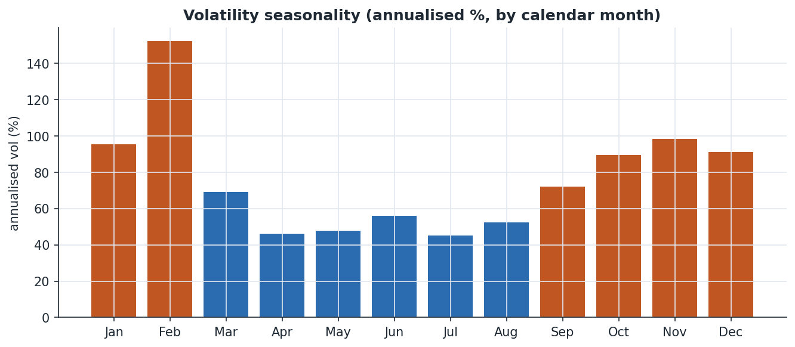

# Energy Commodity Volatility Econometrics

Volatility modelling, regime detection and tail-risk backtesting for energy
commodity prices, built around a reusable, commodity-agnostic Python library.

The reference series here is the **Henry Hub natural gas spot price** (daily,
Jan 1997 – Apr 2023, 6,860 business-day observations). The same pipeline runs on
**Brent** or **WTI** by changing one argument — see
[Extending to other commodities](#extending-to-other-commodities).

---

## Overview

Energy prices are a hard case for the standard finance toolkit: fat tails,
violent volatility clustering, abrupt crisis regimes, and — for natural gas —
strong calendar seasonality from heating demand. This project works through that
empirically rather than assuming it away:

1. establish the order of integration (model returns, not prices);
2. confirm and then model conditional heteroskedasticity with the GARCH family;
3. test whether energy volatility responds asymmetrically to the sign of shocks
   (it does not behave like equities);
4. validate the volatility model **out of sample**, not just in sample;
5. identify calm-vs-crisis regimes with a Markov-switching model and date the
   historical episodes;
6. turn the volatility model into Value-at-Risk / Expected Shortfall and
   **backtest** it with the Kupiec and Christoffersen coverage tests;
7. quantify the seasonality of gas volatility.

Every result below is reproduced by `python run_analysis.py`.

---

## Headline results

| Question | Finding |
|---|---|
| Are spot prices stationary? | No — log price is **I(1)** (ADF p ≈ 0.05, KPSS rejects); log returns are **I(0)**. Modelling is done on returns. |
| Is there volatility clustering? | Overwhelmingly — ARCH-LM(10) ≈ 2,473 (p ≈ 0), excess kurtosis ≈ **51**. A fat-tailed (Student-t) GARCH is warranted. |
| Best volatility model? | **EGARCH(1,1)-t**, lowest AIC *and* best out-of-sample QLIKE/MSE. |
| Volatility persistence? | ≈ **0.98** (GJR-GARCH) — shocks decay very slowly. |
| Leverage effect? | The asymmetry term γ ≈ **−0.01**, i.e. *not* the equity-style "bad news raises vol more" pattern. Energy behaves differently. |
| Are there volatility regimes? | Yes — a **calm** regime (≈46% annualised vol, ~43-day duration) and a **crisis** regime (≈188% annualised vol, ~7-day duration). |
| Does the risk model hold up? | 1-day VaR passes **Kupiec and Christoffersen** at both 5% and 1%. |
| Is gas volatility seasonal? | Strongly — **February ≈ 152%** vs summer ≈ 45% annualised; seasonal dummies jointly significant at p ≈ 6×10⁻¹². |

---

## The analysis, step by step

### 1. Data

Daily Henry Hub spot prices are reindexed to a business-day calendar, sparse
gaps forward-filled, and converted to percentage log returns. Returns are scaled
by 100 because GARCH likelihood optimisers are far better conditioned on O(1)
data.



The level series shows the structural episodes the rest of the analysis picks up
statistically: the 2000–01 California crisis, the 2005 hurricane season, the
2008 spike, and the 2021 Winter Storm Uri move to roughly $24/MMBtu.

### 2. Order of integration

Two tests with opposite null hypotheses are run on both the log price and the
log return, because agreement across the pair is far more convincing than either
test alone.

| series | ADF stat | ADF p | KPSS stat | KPSS p | verdict |
|---|---|---|---|---|---|
| log price | −2.86 | 0.05 | 1.62 | <0.01 | non-stationary **I(1)** |
| log return | −16.84 | <0.001 | 0.04 | >0.10 | stationary **I(0)** |

Prices carry a unit root; returns do not. Everything downstream is modelled on
returns.

### 3. Volatility clustering (ARCH effects)



The return series is visibly clustered — quiet stretches interrupted by bursts.
Formally:

- Ljung–Box Q(10) on squared returns ≈ **3,920** (p ≈ 0)
- Engle ARCH-LM(10) ≈ **2,473** (p ≈ 0)
- unconditional excess kurtosis ≈ **51**



The slowly decaying autocorrelation in squared returns is the signature of ARCH
effects and motivates a GARCH specification with Student-t innovations.

### 4. The GARCH family and the asymmetry question

Three specifications are estimated with Student-t errors:

| model | log-lik | params | AIC | BIC |
|---|---|---|---|---|
| **EGARCH(1,1)** | −18,395.1 | 6 | **36,802.2** | **36,843.2** |
| GARCH(1,1) | −18,427.0 | 5 | 36,863.9 | 36,898.1 |
| GJR-GARCH(1,1) | −18,426.8 | 6 | 36,865.6 | 36,906.6 |

EGARCH is preferred on both information criteria. The estimated Student-t has
≈ 4 degrees of freedom — very heavy tails, exactly as the kurtosis warned.



**The asymmetry result is worth dwelling on.** In equity markets the GJR/EGARCH
asymmetry term is positive: negative returns raise future volatility more than
positive ones (the "leverage effect"). Here the GJR γ ≈ −0.01 — essentially
absent, if anything mildly reversed. That is consistent with the economics of
energy: a *positive* price shock often signals a supply scare (a hurricane, a
pipeline outage, a cold snap) that is itself destabilising, so the sign
asymmetry that dominates equities does not carry over. This is the kind of
finding that distinguishes a model fitted to commodities from a model fitted out
of an equities textbook.

The fitted Student-t captures the tails of the standardised residuals far better
than a Gaussian:



### 5. Out-of-sample validation

In-sample AIC can flatter an over-fit model, so each specification is also run
through an expanding-window, one-step-ahead variance forecast over the final 500
trading days (re-estimated every 25 days) and scored against realised squared
returns with QLIKE (the standard robust loss) and MSE.

| model | QLIKE | MSE |
|---|---|---|
| **EGARCH(1,1)** | **4.553** | **12,448** |
| GARCH(1,1) | 4.557 | 12,578 |
| GJR-GARCH(1,1) | 4.563 | 12,558 |

EGARCH wins out of sample too — the in-sample preference is not an artefact of
over-fitting.

### 6. Regime switching

A single GARCH process assumes one regime forever. A two-state Markov-switching
model (switching mean and variance) instead lets the series move between a calm
and a crisis state governed by a hidden Markov chain.

| regime | daily vol | annualised vol | stay prob. | expected duration |
|---|---|---|---|---|
| calm | 2.87% | 45.5% | 0.977 | ~43 days |
| crisis | 11.83% | 187.8% | 0.855 | ~7 days |



The smoothed crisis-regime probability (lower panel) lights up exactly where it
should: 2000–01, 2003, 2005, 2008–09, and the 2021–22 cluster. The model
recovers the market's known stress episodes without being told where they are —
a useful, interpretable complement to the continuous GARCH volatility.

### 7. Value-at-Risk and Expected Shortfall

The fitted GJR-GARCH-t implies a one-day VaR and ES path. The VaR is then
backtested with the two standard coverage tests — Kupiec (right *number* of
breaches) and Christoffersen (breaches *independent*, not clustered in crises).

| level | expected | observed | breach rate | Kupiec p | Christoffersen p | pass |
|---|---|---|---|---|---|---|
| 5% | 343 | 358 | 5.22% | 0.41 | 0.61 | ✅ |
| 1% | 69 | 55 | 0.80% | 0.09 | 0.15 | ✅ |



The model is neither too aggressive nor too conservative, and the breaches are
not clustered — the dangerous failure mode where a risk model looks fine in calm
periods but goes blind in a crisis.

### 8. Seasonality



Natural gas volatility is sharply seasonal: **February ≈ 152%** annualised
against a summer trough near 45%, with a secondary autumn build (Oct–Dec) as
storage and winter risk come into focus. A regression of squared returns on
month dummies rejects the no-seasonality null at p ≈ 6×10⁻¹². (Run the same code
on Brent and the profile flattens — crude does not share gas's heating-demand
calendar, which is itself an informative contrast.)

---

## Repository layout

```
energy-econometrics/
├── README.md
├── requirements.txt
├── run_analysis.py            # end-to-end runner; writes everything in outputs/
├── data/
│   └── henry_hub_spot.csv     # EIA daily spot snapshot (public domain)
├── src/
│   ├── data.py                # loading, cleaning, FRED fetch (commodity-agnostic)
│   ├── diagnostics.py         # ADF / KPSS stationarity, ARCH-effect tests
│   ├── volatility.py          # GARCH / GJR / EGARCH, selection, OOS forecast
│   ├── regime.py              # 2-state Markov-switching model
│   ├── risk.py                # VaR / ES + Kupiec & Christoffersen backtests
│   ├── seasonality.py         # monthly vol profile + seasonal dummy regression
│   └── plots.py               # figure generation (house style)
├── notebooks/
│   └── analysis.ipynb         # narrative walkthrough
├── outputs/
│   ├── figures/               # generated PNGs
│   └── tables/                # generated CSV result tables
└── tests/
    └── test_pipeline.py       # smoke tests for the core routines
```

---

## Reproducing the results

```bash
pip install -r requirements.txt
python run_analysis.py
```

This regenerates every figure in `outputs/figures/` and every table in
`outputs/tables/` from the bundled data, with no network access required.

---

## Extending to other commodities

The library is commodity-agnostic. To pull a fresh series straight from the
St. Louis Fed (FRED — no API key needed) and run the full analysis on Brent:

```bash
python run_analysis.py --commodity brent --live
```

Or from Python:

```python
from src import data, volatility, regime, risk

ps = data.fetch_fred("brent")          # or "wti", "henry_hub"
fit = volatility.fit_one(ps.ret, "EGARCH(1,1)")
rm = regime.fit_regimes(ps.ret)
bt = risk.backtest_table(ps.ret, volatility.fit_one(ps.ret, "GJR-GARCH(1,1)"))
```

FRED series IDs used: Henry Hub `DHHNGSP`, Brent `DCOILBRENTEU`, WTI
`DCOILWTICO`.

---

## Data and attribution

The bundled `data/henry_hub_spot.csv` is the U.S. Energy Information
Administration (EIA) Henry Hub Natural Gas Spot Price (daily, $/MMBtu), which is
public-domain U.S. government data. It is committed only as a reproducibility
snapshot; the live loader re-downloads the current series from FRED on request.

---

## Methods reference

- Dickey & Fuller (1979); Kwiatkowski, Phillips, Schmidt & Shin (1992) — unit-root testing.
- Bollerslev (1986) — GARCH; Glosten, Jagannathan & Runkle (1993) — GJR-GARCH; Nelson (1991) — EGARCH.
- Hamilton (1989) — Markov regime-switching.
- Kupiec (1995); Christoffersen (1998) — VaR backtesting.
- Patton (2011) — robust loss functions (QLIKE) for volatility forecast evaluation.

Built with `arch`, `statsmodels`, `scipy`, `pandas` and `matplotlib`.
